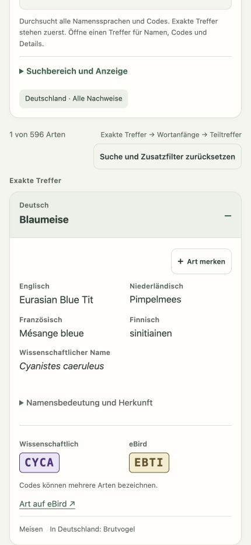
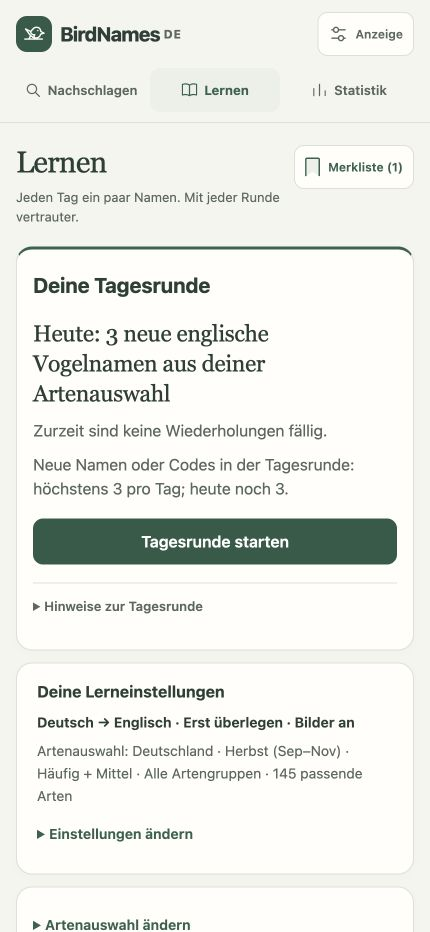
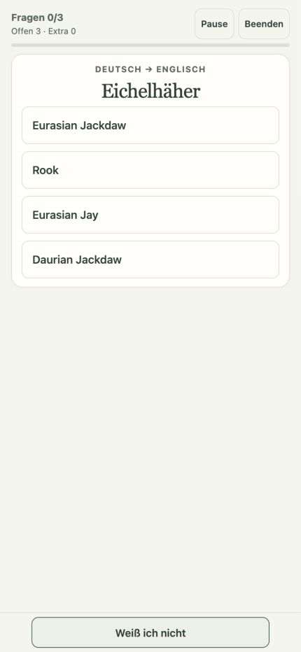
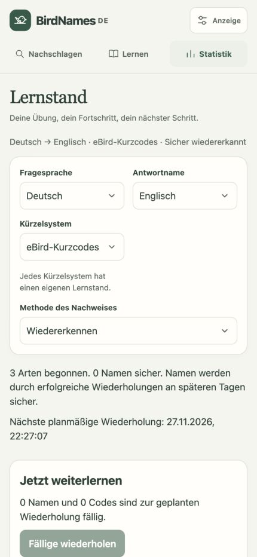
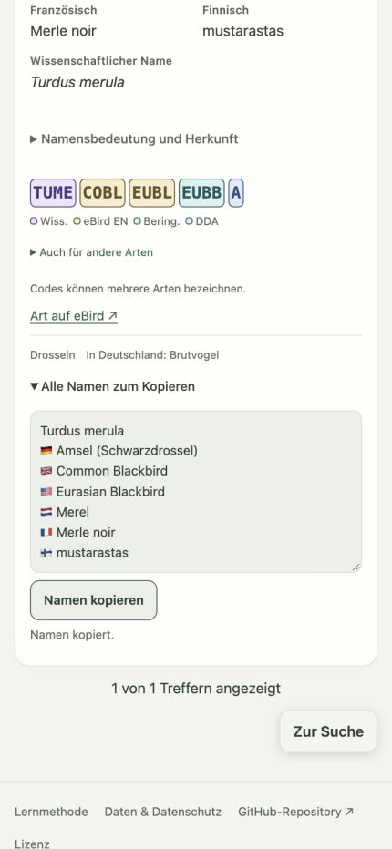

# BirdNames DE

Look up and learn bird names with spaced practice. The catalogue covers 994 species
recorded in Germany, the Netherlands, the UK, Finland and France, with German,
English, Dutch, French, Finnish and scientific names. Interface: German or English.

**[Open BirdNames DE](https://dg1tal.github.io/birdnamesde/)** — desktop or mobile,
no account required.

## Features on mobile

German interface, captured on 26 November 2026. Click images for full size.

<table>
  <tr>
    <td width="50%" valign="top">
      <h3>Find names across languages</h3>
      <p>Search any name or code; open a result to compare languages.</p>
      <a href="docs/screenshots/mobile-lookup.jpg"></a>
    </td>
    <td width="50%" valign="top">
      <h3>Build a daily learning habit</h3>
      <p>Choose region, season and languages; review due targets and learn new ones.</p>
      <a href="docs/screenshots/mobile-daily-learning.jpg"></a>
    </td>
  </tr>
  <tr>
    <td width="50%" valign="top">
      <h3>Practise bird names</h3>
      <p>Reveal choices when ready, or use text entry, flashcards or direct multiple choice.</p>
      <a href="docs/screenshots/mobile-practice.jpg"></a>
    </td>
    <td width="50%" valign="top">
      <h3>Keep track of your progress</h3>
      <p>Track started species, secure targets and scheduled reviews by language and method.</p>
      <a href="docs/screenshots/mobile-progress.jpg"></a>
    </td>
  </tr>
  <tr>
    <td width="50%" valign="top">
      <h3>Understand each answer</h3>
      <p>See accepted names, scientific references, codes, credited pictures and explanations.</p>
      <a href="docs/screenshots/mobile-feedback.jpg"></a>
    </td>
    <td width="50%" valign="top">
      <h3>Save birds for later</h3>
      <p>Practise a saved list with your chosen languages and method.</p>
      <a href="docs/screenshots/mobile-saved-species.jpg"></a>
    </td>
  </tr>
</table>

430 × 932 CSS pixels, light theme, isolated local preview. Statistics show a
three-question example round. [Capture states and limits](docs/readme-screenshots-20261126.md).

Feedback photo: I, Luc Viatour,
[Eurasian Jay](https://commons.wikimedia.org/wiki/File:Garrulus_glandarius_1_Luc_Viatour.jpg),
[CC BY-SA 3.0](https://creativecommons.org/licenses/by-sa/3.0/).

## Copy bird names

Open **All names for copying → Copy names** at the bottom of a species card.
The text includes the scientific name, all available languages, German alternatives
and distinct British/US names, regardless of display settings. If clipboard access
fails, the text is selected for manual copying.

<a href="docs/screenshots/mobile-copy-names.jpg"></a>

## Save birds for later practice

Choose **Save species**, then open **Saved species** from Lookup or Learn. Saved
rounds use only that list; resume or end a paused round before starting another.

## How learning works

Choose a region, question/answer languages and text entry, flashcards, multiple
choice or “Think first”. Daily rounds prioritise due reviews and introduce at most
three new targets per day across languages and methods. Custom rounds allow more.
Started targets remain eligible for review when region/season filters change.

Photos appear during introductions and after answers. Progress stays separate by
language direction and method family. German alternatives are shown when relevant;
ambiguous names are labelled. The in-app **Learning method** page explains the
schedule; [learning and storage](docs/learning-and-storage.md) documents the rules.

## Privacy and limits

Progress and saved species stay in your browser. There are no accounts, analytics
or automatic device sync. Browser cleanup can remove them.

Use **Statistics → Back up and restore progress** to export `.json` or `.json.gz`.
Confirmed import replaces progress; preferences and paused rounds are excluded.
Export from the old browser/origin before moving. [Backup details](docs/learning-and-storage.md#backup-and-restore-flow).

The app requires static hosting and has no guaranteed offline mode. eBird API
refreshes run through GitHub Actions; the browser loads published data. Regional
filters describe occurrence, not sighting probability or breeding status.

## Run locally and check

No build step or npm install is needed. From the repository root:

```sh
python3 -m http.server 8000 --directory dist
```

Open [localhost:8000](http://localhost:8000/). Run `npm test` for the baseline check;
[development](docs/development.md) lists the full CI checks. The
[Pages workflow](.github/workflows/pages.yml) publishes `dist/` from `main`.

## Data sources and acknowledgement

Taxonomy/common names use eBird/Clements 2025; official quick codes use the 2026
workbook with reviewed exceptions. DDA supplies separate breeding-survey codes.
Dutch/French cover all 994 species; Finnish covers 986. Name explanations primarily
use Jobling (2010). [Sources and reproduction](docs/data-sources.md).

Seasonal groups use **EBD observations from 2021–2025**: September 2026 release for
DE/NL/GB, October for FI/FR. Regional lists/current reports use the eBird API.
**Raw EBD archives and observation records are not included**; only derived
regional groups and sample counts are published.

> eBird Basic Dataset. Version: EBD_relSep-2026. Cornell Lab of Ornithology, Ithaca, New York. Sep 2026.

> eBird Basic Dataset. Version: EBD_relOct-2026. Cornell Lab of Ornithology, Ithaca, New York. Oct 2026.

Sullivan, B.L., C.L. Wood, M.J. Iliff, R.E. Bonney, D. Fink, and S. Kelling. 2009.
eBird: a citizen-based bird observation network in the biological sciences.
Biological Conservation 142: 2282–2292.
[DOI](https://doi.org/10.1016/j.biocon.2009.05.006).

Thanks to Cornell Lab of Ornithology and eBird contributors.
[Source EBD](https://science.ebird.org/en/use-ebird-data/download-ebird-data-products).
Derived data retain the [eBird Data Access Terms](https://www.birds.cornell.edu/home/ebird-data-access-terms-of-use/),
also in `dist/ebd-terms.txt`. Attribution does not imply endorsement.

## License and third-party material

Application code, scripts and configuration: [MIT](LICENSE), © 2026 DG1TAL;
`dist/LICENSE` accompanies the hosted app. This excludes JSON datasets, images
and other third-party material. Image credits/licences are in `dist/photos.json`.
eBird materials retain their [API](https://www.birds.cornell.edu/home/ebird-api-terms-of-use/)
and [data access terms](https://www.birds.cornell.edu/home/ebird-data-access-terms-of-use/).

## Further documentation

| Guide | Contents |
| --- | --- |
| [Development](docs/development.md) | Modules, checks, dependencies, accessibility |
| [Learning and storage](docs/learning-and-storage.md) | Scheduling, saved species, backups, recovery |
| [Data sources](docs/data-sources.md) | Taxonomy, names, codes, photos, reproduction |
| [Deployment and regions](docs/deployment-and-regions.md) | Pages, API refreshes, seasonal selection |
| [Private EBD import](docs/ebd-import.md) | Archives, aggregation, coverage, terms |
| [Search design](docs/search-design-20261108.md) | Ranking and match provenance |

Dated reports in `docs/` record individual reviews; the guides above describe
current behavior.
