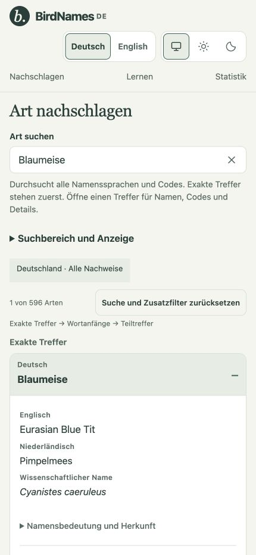
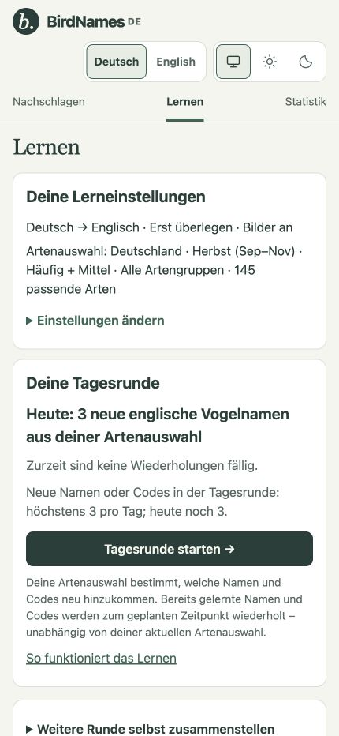
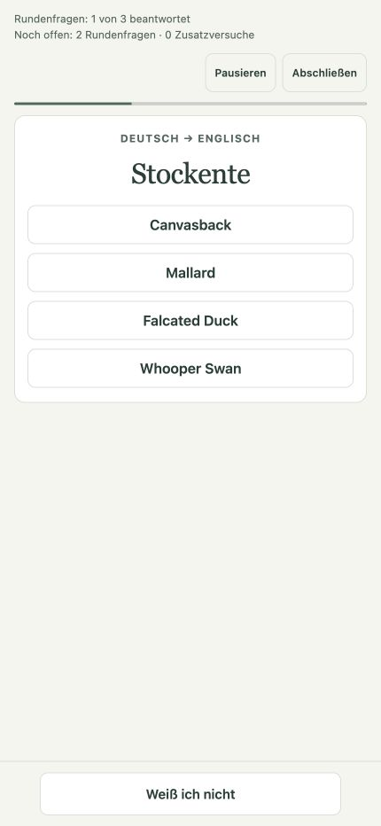
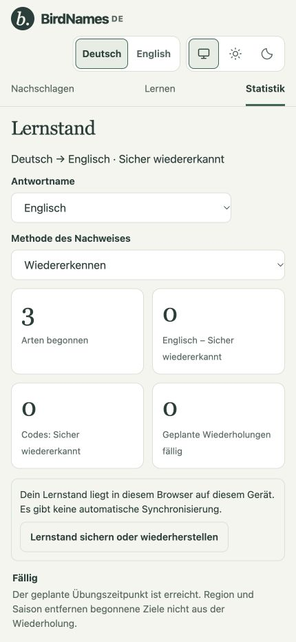

# BirdNames DE

Look up bird names and learn them with short, spaced-repetition practice rounds. The catalogue covers 940 species recorded in Germany, the Netherlands and the United Kingdom, with German, English, Dutch and scientific names. The interface is available in German and English.

**[Open BirdNames DE](https://dg1tal.github.io/birdnamesde/)** — use it in your desktop or mobile browser, without an account.

## Features on mobile

<table>
  <tr>
    <td width="50%" valign="top">
      <h3>Find names across languages</h3>
      <p>Search names and codes, then open a species to compare German, English, Dutch and scientific names.</p>
      <a href="docs/screenshots/mobile-lookup.jpg"></a>
    </td>
    <td width="50%" valign="top">
      <h3>Build a daily learning habit</h3>
      <p>Choose your region, season and languages. Daily rounds introduce a few new targets and bring back scheduled reviews.</p>
      <a href="docs/screenshots/mobile-daily-learning.jpg"></a>
    </td>
  </tr>
  <tr>
    <td width="50%" valign="top">
      <h3>Practise bird names</h3>
      <p>Think first, then reveal the choices. Text input, flashcards and direct multiple choice are also available.</p>
      <a href="docs/screenshots/mobile-practice.jpg"></a>
    </td>
    <td width="50%" valign="top">
      <h3>Keep track of your progress</h3>
      <p>See started species, secure learning targets and due reviews by language and method. Back up or restore your browser-local progress.</p>
      <a href="docs/screenshots/mobile-progress.jpg"></a>
    </td>
  </tr>
</table>

German interface, captured on 8 November 2026 at 430 × 932 CSS pixels (iPhone-sized viewport). Statistics show a three-question example round. Click an image to view it at full size.

## How learning works

Choose the names or codes you want to practise, your question and answer languages, and a region. Seasonal frequency groups help select new species; current notable reports can add species to that selection. These are occurrence-based learning filters, not sighting predictions.

Your daily round prioritises due reviews and introduces at most three new names or codes per day across languages and methods. New targets are introduced before they are tested. Started targets stay eligible for scheduled reviews when you change your region or season. You can also build a custom round or continue practising after the daily round.

Choose text input, flashcards, multiple choice or “Think first”, which initially hides the choices. Photos appear during introductions and after answers when pictures are enabled. Statistics distinguish recognition, free recall and self-assessment; progress in one method or language direction does not automatically count as secure knowledge in another.

The app explains its scheduling rules and research references under **Learning method**. See [learning, languages and storage](docs/learning-and-storage.md) for implementation details.

## Privacy and limits

Learning progress is stored in your browser on your device. There is no authentication, analytics, server-side progress database or automatic account/device sync. Browser privacy settings or storage cleanup can remove local progress.

Use **Statistics → Back up and restore progress** to export a portable backup. Importing a backup replaces the destination browser’s progress after confirmation. Preferences and paused lessons are not included. Before changing browsers or site domains, export from the old location first.

There is no promised offline mode. The app loads its data and photos from static hosting; regional eBird updates run through GitHub Actions, and the browser does not contact the eBird API. Country-list membership records occurrence, including historical rarities and some introduced or escaped birds; it does not establish breeding status. See the in-app **Data & privacy** page for coverage, source periods and limitations.

## Run locally and check

The app has no runtime dependencies or build step. From the repository root, serve `dist/`:

```sh
python3 -m http.server 8000 --directory dist
```

Open [localhost:8000](http://localhost:8000/). No npm install is needed. Run the baseline application check with:

```sh
npm test
```

CI also runs the complete Node/Python suites, data reproducibility checks and photo validation before deployment. See [development and verification](docs/development.md) for the full commands and CI runtime versions. The [Pages workflow](.github/workflows/pages.yml) publishes `dist/` from `main`; [deployment and regional data](docs/deployment-and-regions.md) describes hosting and refresh configuration.

## Data sources and acknowledgement

Taxonomy and common names use the reviewed eBird/Clements 2025 catalogue. Official quick codes come from the 2026 workbook, with documented exceptions and concept-verified scientific-name updates. National lists cover DE, NL and GB; regional occurrence lists and current notable reports use the eBird API. Scientific-name meanings are short editorial explanations with linked references, principally Jobling (2010). Photos and illustrations have individual source credits and licences.

**The eBird Basic Dataset (EBD) itself is not included in this repository.**
Neither the country download archives nor raw observation or sampling-event
records are published here. The seasonal data files contain derived aggregates:
regional species groups and summary checklist counts.

The seasonal frequency groups for Germany, the Netherlands and the UK are derived
from the **eBird Basic Dataset (EBD), September 2026 release**, restricted to
2021–2025. Regional occurrence lists and current notable reports use the eBird API.

Source dataset used to calculate the seasonal aggregates:

> eBird Basic Dataset. Version: EBD_relSep-2026. Cornell Lab of Ornithology, Ithaca, New York. Sep 2026.

General eBird project reference:

Sullivan, B.L., C.L. Wood, M.J. Iliff, R.E. Bonney, D. Fink, and S. Kelling. 2009. eBird: a citizen-based bird observation network in the biological sciences. Biological Conservation 142: 2282-2292.
[DOI](https://doi.org/10.1016/j.biocon.2009.05.006).

We thank the Cornell Lab of Ornithology for providing the eBird data and the eBird
contributors for their observations. The source EBD is available through the
[official eBird data access page](https://science.ebird.org/en/use-ebird-data/download-ebird-data-products).
Derived data retain the [eBird Data Access Terms of Use](https://www.birds.cornell.edu/home/ebird-data-access-terms-of-use/),
including the full terms distributed in `dist/ebd-terms.txt`; they are excluded from
the code's MIT licence. Attribution does not imply endorsement by Cornell or eBird.

Source records, workbook links, DDA selection provenance, code policy, scientific-name references and image acquisition details are collected in [data sources and reproduction](docs/data-sources.md). The [EBD import guide](docs/ebd-import.md) documents seasonal aggregate calculation and source terms.

## License and third-party material

The original application code in `dist/` (HTML, CSS and JavaScript), the code in `scripts/`, and project configuration are licensed under the [MIT License](LICENSE), copyright (c) 2026 DG1TAL. A copy of the license in `dist/LICENSE` accompanies the hosted application. This grant does not cover the JSON datasets, images, or other third-party material in this repository.

The photos and illustrations in `dist/images/` retain their individual licenses and attribution requirements, recorded per image in `dist/photos.json`. The eBird/Clements taxonomy, common names, quick codes, EBD-derived seasonal groups and API-derived regional data are sourced from Cornell Lab of Ornithology/eBird; this project's MIT license does not grant rights to those materials. Review the [eBird API terms](https://www.birds.cornell.edu/home/ebird-api-terms-of-use/) and [eBird data access terms](https://www.birds.cornell.edu/home/ebird-data-access-terms-of-use/) before reusing or redistributing them. Other source material and editorial provenance are documented in [data sources and reproduction](docs/data-sources.md).

## Further documentation

| Guide | Contents |
| --- | --- |
| [Development and verification](docs/development.md) | Modules, full checks, optional tooling, photo cache and accessibility verification |
| [Learning, languages and storage](docs/learning-and-storage.md) | Scheduling, language contexts, lesson recovery, backups and storage compatibility |
| [Data sources and reproduction](docs/data-sources.md) | Taxonomy, catalogue, names, codes, photo provenance and reproduction commands |
| [Deployment and regional data](docs/deployment-and-regions.md) | GitHub Pages, regional API refresh, seasonal selection and current reports |
| [Private EBD import](docs/ebd-import.md) | Aggregate calculation, review and activation; raw records remain outside Git |
| [Search design](docs/search-design-20261108.md) | Multilingual lookup ranking and match provenance |

Dated reviews in `docs/` record the scope and results of individual releases. Start with the thematic guides above for current behavior.
